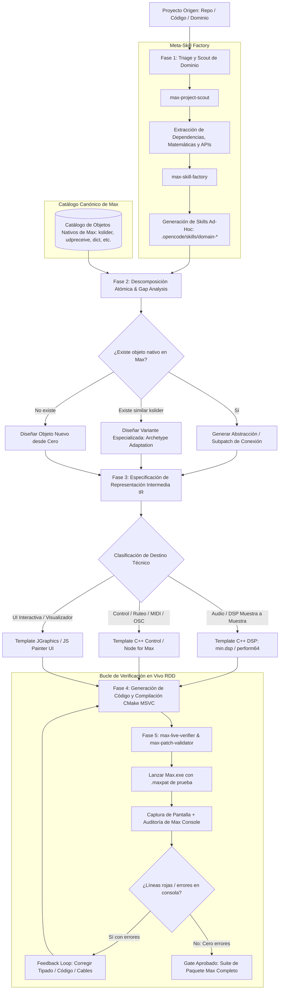

# Arquitectura del Meta-Traductor para Max MSP (Max Transpiler & Ecosystem Generator)

> **Misión del Proyecto**: Crear un framework inteligente, modular y extensible que tome cualquier proyecto de software externo (independientemente del lenguaje de origen) y lo traduzca/porte al paradigma de Max MSP, abstrayendo algoritmos en objetos atómicos (*externals* C++, scripts *Node for Max*, o componentes UI), reutilizando la infraestructura canónica de Max y generando automáticamente skills de dominio especializadas.

---

## 1. Filosofía de Diseño: "The Max Native Way"

1. **CERO Hardcoding (Dynamic Contract Matching)**: 
   - Prohibido conectar cables o índices de inlets/outlets a ciegas o "de memoria".
   - Todo objeto nativo de Max y todo external generado debe registrar su contrato formal de tipos en `core/schema/max_contracts.json`.
   - El enrutador del traductor debe consultar dinámicamente este contrato: si un dato es un canal MIDI, el contrato resuelve que el inlet de `midiformat` es el índice 6, nunca un índice hardcodeado en un script.
2. **Modularidad Atómica sobre Monolitos**: En Max MSP nunca se traslada un proyecto gigantesco a un solo objeto de miles de líneas. Se descompone en objetos con responsabilidades únicas (*Single Responsibility Principle*): generadores, transformadores, ruteadores y visualizadores.
3. **Reutilización y No-Reinvención (Canonicity First)**: 
   - Si Max ya tiene primitivas (`udpreceive`, `udpsend`, `OpenSoundControl`, `mtof`, `scale`, `coll`, `dict`), el traductor **no** reinventa la rueda: genera el patch/abstracción que las conecta.
   - Si existe un objeto análogo estándar (como `kslider` para teclado cromático de 12 tonos), el traductor analiza su contrato (inlets, outlets, atributos, inspectores, mensajes de pitch/velocity) y lo toma como arquetipo para diseñar la variante especializada (ej. `wilson.hexslider` para teclados microtonales hexagonales).
4. **Gobierno Estricto de Hilos (Threading Safety)**:
   - **Hilo DSP (Audio Interrupt)**: C++ nativo vía `min-devkit` / `max-sdk-base` (`perform64`). Cero `malloc`, cero bloqueos, cero llamadas al OS.
   - **Hilo Scheduler / Main**: C/C++ clásico o Node for Max para lógica pesada, parsing o I/O.
   - **Hilo Gráfico / UI**: JGraphics (C++) o JS Painter / Dict para visualización.

---

## 2. Diagrama de Flujo del Meta-Traductor



---

## 3. Capas Arquitectónicas del Sistema

### Capa 1: Meta-Skill Factory (Generación de Inteligencia de Dominio)
- **`max-project-scout`**: Inspecciona el repositorio entrante, detecta stack (TypeScript, Python, C++, etc.), aísla los algoritmos matemáticos y genera el reporte `recursos_<proyecto>.md` con papers, fórmulas y referencias oficiales.
- **`max-skill-factory`**: Con base en `skill-creator`, crea al vuelo skills locales en `.opencode/skills/` específicas del dominio del proyecto (ej. `wilson-tuning-auditor`, `fretboard-geometry-expert`).

### Capa 2: Descomposición y Mapeo Canónico (The Max Mapper)
- **Auditoría de Primitivas**: Compara los requerimientos del proyecto contra el catálogo de objetos estándar de Max.
- **Diseño de Arquetipos**: Si el proyecto requiere una interfaz de teclado, no parte de la nada: toma el comportamiento de `kslider` (mouse down, note-on, note-off, drag, visual feedback, atributos de inspector) y proyecta las diferencias microtonales (coordenadas hexagonales, afinaciones arbitrarias, ratios/cents).
- **Desglose en Micro-Objetos**: Define la lista de objetos atómicos a crear (ejemplo para Wilson: `wilson.core` para el cálculo de notas, `wilson.hexslider` para la interfaz, `wilson.tuning` para la conversión de frecuencias).

### Capa 3: Representación Intermedia (IR)
Para cada objeto atómico identificado, el sistema genera un esquema agnóstico en formato JSON/YAML:
```yaml
object_name: "wilson.hexslider"
category: "UI / Control"
archetype: "kslider"
target_runtime: "c++_jgraphics" # o "js_painter"
inlets:
  - id: 0
    type: "list / int"
    description: "Mensajes de control, selección de nota activa, configuración de escala"
outlets:
  - id: 0
    type: "int / float"
    description: "Pitch / Ratio / Frecuencia resultante al hacer clic"
  - id: 1
    type: "int"
    description: "Velocity (0 al soltar, >0 al presionar)"
attributes:
  - name: "scale_ratios"
    type: "atom_array"
    default: "1/1 9/8 5/4 4/3 3/2 5/3 15/8 2/1"
  - name: "grid_geometry"
    type: "symbol"
    enum: ["hexany", "eikosany", "custom"]
```

### Capa 4: Generador de Código y Plantillas (Code Engine)
Repositorio de esqueletos estándar (`templates/`):
- `min-object-control/`: Objeto C++ moderno para mensajes, listas y lógica.
- `min-object-dsp/`: Objeto C++ `min.dsp` para audio de alto rendimiento.
- `node-script-wrapper/`: Plantilla para librerías asíncronas de JavaScript/TypeScript complejas.
- `jgraphics-ui/`: Esqueleto para objetos con representación visual interactiva.

### Capa 5: Verificador de Compilación y Calidad (RDD / Gatekeeper)
- Ejecución de CMake / MSVC en Windows para generar `.mxe64`.
- Verificación de carga en runtime y ausencia de violaciones de audio thread.

---

## 4. Estrategia de Benchmark Gradual (Casos Reales)

Para validar el framework, abordaremos los proyectos de menor a mayor complejidad:

1. **Benchmark 1 (Piloto Atómico)**: Un módulo matemático aislado de `Teclados-Wilson` (cálculo de ratios de Hexany y afinación microtonal). Validar extracción, generación de objeto en C++ y comparación contra objetos nativos.
2. **Benchmark 2 (UI + Arquetipo)**: Creación de la variante especializada inspirada en `kslider` para el teclado hexagonal (`wilson.hexslider`).
3. **Benchmark 3 (Geometría + Audio)**: Integración de `Diapason-microtonal` (mástil/trastes) traduciendo la lógica de fretboard a objetos visuales y de control.
4. **Benchmark 4 (Infraestructura y Networking)**: Integración con `midiControl` (ruteo MPE, MIDI y OSC), reutilizando las primitivas nativas de red y MIDI de Max y creando solo las capas de puente necesarias.
