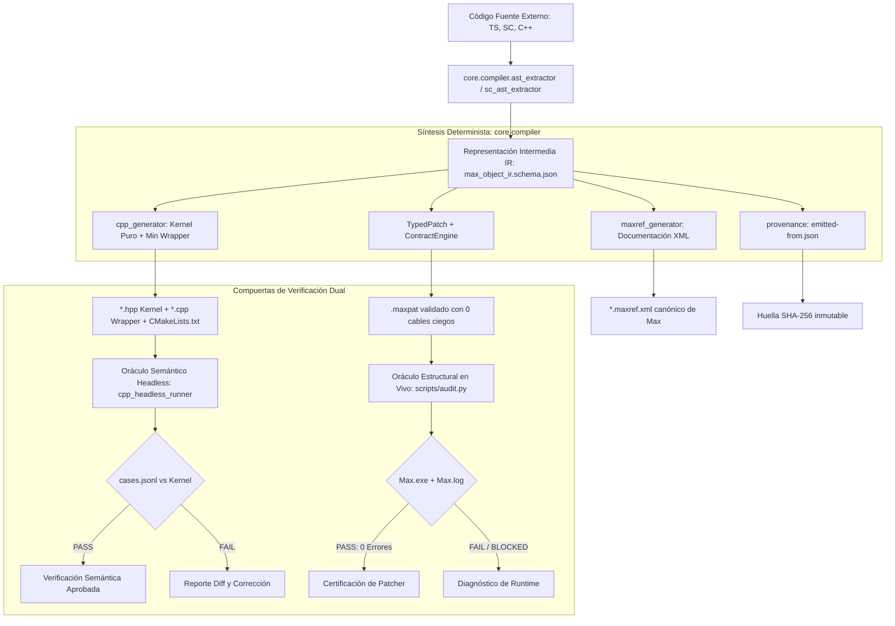

# Arquitectura del Meta-Traductor para Max MSP (Harmos Compiler Framework)

> **Misión del Proyecto**: Framework inteligente, modular y determinista que toma especificaciones de software externo (TypeScript, Python, C++, SuperCollider) y las compila al modelo nativo de Cycling '74 Max MSP: objetos atómicos C++ Min-Devkit (`.mxe64`/`.mxo`), patchers validados bajo contratos estrictos (`.maxpat`), esqueletos CMakeLists.txt, documentación canónica (`.maxref.xml`) y huellas criptográficas de procedencia (`emitted-from.json`).

---

## 1. Filosofía de Diseño: "The Max Native Way"

1. **CERO Hardcoding (Dynamic Contract Matching)**:
   - Prohibido conectar cables o asumir índices de inlets/outlets a ciegas o "de memoria".
   - Todo objeto nativo de Max y todo external sintetizado valida su firma formal de tipos mediante `ContractEngine` y `core/schema/max_contracts.json`.
   - Soporte para aridad dinámica (`unpack`, `pack`, `trigger`, `route`), uniones de señal/control y validación bidireccional estricta.
2. **Desacoplamiento Arquitectónico (Kernel Puro vs. Wrapper Min-Devkit)**:
   - Los algoritmos de procesamiento y síntesis residen en **Kernels C++ Puros** (`*_kernel.hpp`) libres de dependencias del SDK de Max.
   - La capa Max reside en **Wrappers Min-Devkit** delgados (`*.cpp`), permitiendo evaluación headless instantánea en cualquier runner de CI sin requerir Max.exe ni CMake complejo.
3. **Dual Oracle Verification (Estructural + Semántico)**:
   - **Oráculo Estructural en Vivo (`scripts/audit.py`)**: Despliega patchers sintetizados en instancias reales de `Max.exe`, audita la consola interna (`Max.log`), detecta colisiones de DSP o errores de cableado en runtime.
   - **Oráculo Semántico Headless (`cases.jsonl` + `cpp_headless_runner.py`)**: Compila el arnés C++ autónomo en el host y evalúa salidas numéricas contra vectores de prueba con tolerancia de coma flotante.
4. **Trazabilidad Criptográfica (Provenance Engine)**:
   - Cada artefacto emitido incluye `emitted-from.json`, registrando hashes SHA-256 de los contratos canónicos, la IR fuente y los archivos generados para garantizar detección inmediata de deriva.
5. **Gobierno Estricto de Hilos (Threading Safety)**:
   - **Hilo DSP (Audio Interrupt)**: C++ nativo vía `min.dsp` (`perform64`). Cero `malloc`, cero bloqueos, cero llamadas de sistema operativo.
   - **Hilo Scheduler / Main**: Lógica de control, mensajes y ruteo.
   - **Hilo Gráfico / UI**: JGraphics (C++) o JS Painter / Dict para visualización interactiva.

---

## 2. Diagrama del Pipeline del Compilador

---

## 3. Componentes Nucleares (`core/compiler/`)

- **`cli.py`**: Interfaz de línea de comandos (`compile`, `extract`, `doc`, `bench`, `harvest`, `diff`, `verify-provenance`).
- **`contract_engine.py`**: Motor de contratos con lookup $O(1)$, aridad dinámica y tipado bidireccional.
- **`typed_patch.py`**: Sintetizador de patchers JSON con `connect_semantic()` y tipado estricto.
- **`cpp_generator.py`**: Generador de Kernel C++ desacoplado y wrapper Min-Devkit con CMakeLists.txt.
- **`cpp_headless_runner.py`**: Arnés headless C++ multi-compilador con registro pluggable de kernels.
- **`oracle_harvest.py` / `oracle_diff.py`**: Cosecha de vectores y comparación semántica con tolerancia.
- **`provenance.py`**: Generación y verificación de huella criptográfica SHA-256 (`emitted-from.json`).
- **`maxref_generator.py`**: Generador de documentación oficial `.maxref.xml` para el inspector de Max.
- **`benchmark.py`**: Evaluador estadístico multi-ronda de presupuestos de tiempo real (SHIP/NO_SHIP).

---

## 4. Meta-Skills de Orquestación (`meta-skills/`)

- **`max-transpiler-scout`**: Auditoría estática de fuentes, extracción políglota de IR y gap analysis.
- **`max-runtime-gatekeeper`**: Automatización de compuertas de auditoría en vivo (`Max.exe`) y oráculos semánticos.
